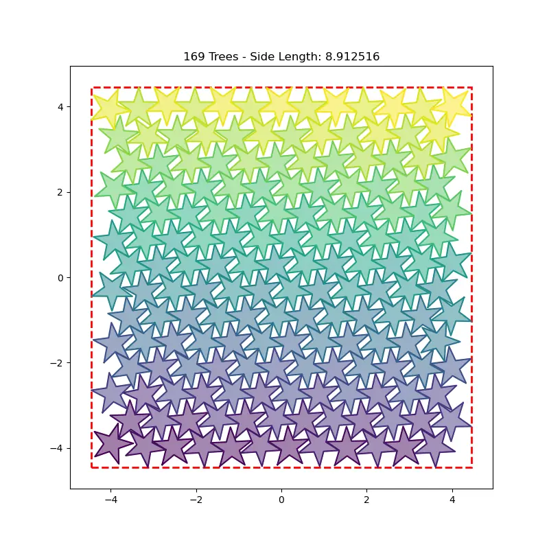
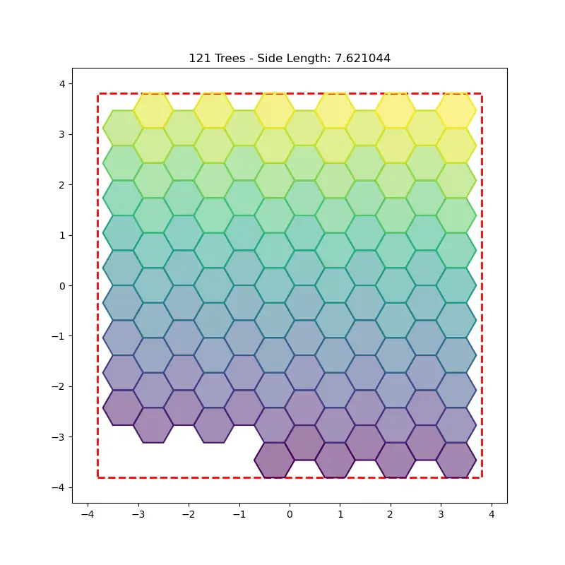

# Approach: Packing Christmas Trees

I wrote down my thought process, along with some remarks, throughout the project.

## Day 1

### What Am I Solving?
I started by thinking broadly: what do I want my solution to cover?
Clients change requirements, and two clients often want similar but not identical things. Choosing a more general approach works better in the long run; overly specific code usually has to be rewritten.

I therefore wanted to support any polygon. The danger is that too general an approach might rule out some significant optimisations.
The instructions hinted that I should use symmetry about the y-axis, so I decided to support symmetric polygons only.

### Which Algorithm?
While chatting back and forth with the AI, I got the suggestion to use different algorithms for different numbers of trees (e.g. algorithm A for 1–60 trees and algorithm B for 61–100).
I liked the idea. It means more computation, but I thought that was worth it as long as the program finishes in a reasonable time. I went for random starts for small numbers of trees and lattice patterns for large ones, then annealing for both.

### Which Programming Language?

I considered:
- **C++:** Seemed like a good option. Many people know it, so other programmers can maintain the code.
- **C:** A quick Google search suggested it has no speed advantage over C++. Fewer people know the language, so I decided against it.
- **Python (and JS):** These are 50–100 times slower than C++. Easy to rule out.
- **Fortran:** The AI suggested it, but it seems better suited to pure mathematical computation.

The only catch was that I had to learn C++. I had experience in C, so I figured it wouldn't be too difficult.

### Input & Output (I/O)
The output had to be a .csv file (per the instructions). Since I wanted to support any symmetric polygon, I avoided hard-coding the tree shape. Instead, the shape lives in a .csv file that the program reads.

### File Structure
My codebase was growing, and I needed to organise it.
First, I made a GitHub repo and added a README.
Then I asked the AI about standard file structures. Apparently there is no single standard for C++, but it suggested:
- `/src`: the program code
- `/build`: the compiled output
- `/data`: the input and output .csv files
- `/tests`: test cases

I figured a CLI could come later.

### The Algorithm
I set the AI to "plan" mode and went back and forth on what a good solution would look like. During this dialogue, I realised that this challenge was a Kaggle competition from 2025… lol.

Once the code was implemented, I wanted to be sure that I understood it (and that anyone else could too). I spent about an hour reading through it and changing small things. Someone is going to look at all my dirty laundry, and I want it clean!

How the final algorithm works is described in the [README](README.md#how-it-works).

### Evaluation
The visualisation tool was really cool.
But my solution failed the overlap check 😲. The visualisation showed no overlapping trees. Confusing...
It turned out the trees overlapped by a floating-point rounding error, far too small to see. So I added a tiny gap between them, and it passed 😃

### Finishing Off
I added the CLI and ran the program a few times. I was not happy with the total score (it was ~95 at the time). The AI suggested some changes and implemented them, which brought the score down to ~75 (lower is better). Good enough.
The downside was that a run on my machine now took up to 5 minutes 😞
That's a pity, but I don't think it's a big issue in production. Just go make a cup of coffee in the meantime.

This took me about 7 hours in total. I had to rush off to Bible study, so I decided to submit my result in the morning.

That night, while talking to friends, I thought: *OK, I've solved the problem, but is this the absolute best I can do? I have an entire week, after all.*

## Day 2

### Quick Optimisation
In the morning I was eager to get the best score I could.
In quick succession, the AI sped up packing for 1–200 trees, then brought the score down from ~75 to 73.75, and then to 72.

Curious where my result would place on Kaggle, I looked at the leaderboard. With 72, I'd be in about 1,750th place.

  

### No Modesty

It became clear that I had been thinking about this project the wrong way.

The goal was not to ship a good product to a client, but to get the absolute best score. I let go of all modesty: I ignored run time and dropped the general symmetric-polygon approach.

From now on, it was just me and the tree (…or the Christmas forest).

Goodbye, `tree.csv`: the tree is now hard-coded as four convex parts, which makes collision checks much faster.

It was a bit sad to let go because the general approach did work. Before hard-coding the tree, I swapped `tree.csv` for other symmetric polygons, and the same program packed them without changing a line of code:

  
  

### Trial and Error

From here on, it was trial and error: letting the AI try approaches, testing them, discarding what didn't work and keeping what did. So I started using Git branches, and had the AI write a benchmark script that showed quickly whether a new strategy worked, without waiting for all 200 packings. A full run now took 50 minutes!

### Breakthrough

Shortly after, the AI suggested keeping the best result in a .csv file and improving on it with every run: if a new result is better, it replaces the best; otherwise it's discarded.

This is what made the biggest difference.

## Days 3–5

From Friday through the weekend, I let the program run non-stop.
By Monday morning, the script was still slowly but surely improving (mostly through the squeeze algorithm), but I decided to stop it there, since I could barely use my computer while it ran. The final score was 70.126.
According to the leaderboard of the "Santa 2025 – Christmas Tree Packing Challenge", I would have placed 89th out of 3,319 submissions.
